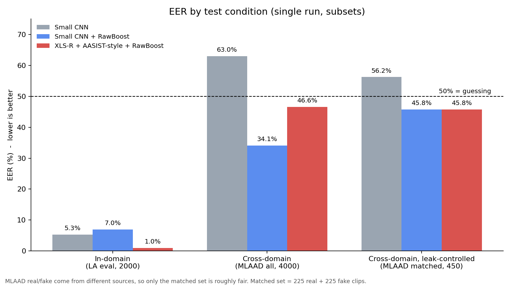

# Voice Deepfake (Anti-Spoofing) Detector

Classifies a short audio clip as **real** (label 0) or **fake / AI-generated** (label 1).
College / resume project. Everything below was measured by me; numbers are on **subsets** and from **one run (one seed)**.



## Repository contents

This repository contains the code, documentation, evaluation outputs and CSV manifests. Raw audio, `MLAAD-tiny/`, `colab_pack*/` and model checkpoints are **not** stored in Git.

- **v3 checkpoint:** download `xlsr_v3.pt` from the [latest release](https://github.com/Narwal-himanshu/voice-deepfake-detector/releases/latest) and place it in `checkpoints/`.
- **Data:** download ASVspoof 2019 LA and MLAAD-tiny from their official sources, then rebuild the CSVs with `prepare_data.py`, `prepare_mlaad.py` and `data_v3.py`. See [Data](#data).
- The old v1/v2 CSV splits are not included because they contain local absolute paths; regenerate them with the preparation scripts if needed.

## Results (EER %, lower is better; 50% = guessing)

| Model | LA eval (in-domain, 2000) | MLAAD all (4000) | MLAAD matched (450) | MLAAD unseen (2000) |
|---|---|---|---|---|
| Small CNN (log-mel) | 5.30 | 63.0 | 56.2 | — |
| Small CNN + RawBoost (algo 4) | 7.00 | 34.1 | 45.8 | — |
| v1: XLS-R 300M + AASIST + RawBoost | **1.00** | 46.6 | 45.8 | — |
| v3: XLS-R 300M, all-layer fusion + shortcut-safe aug | **0.25** | **1.67** | **8.00** | **2.60** |

EER %, lower is better. AUC and calibration are in `MODEL_CARD.md`. v3 is one seed on subsets; read the shortcut caveat in the v3 section before trusting the MLAAD numbers.

## What worked and what did not

- **Worked:** v3 is a large improvement on both domains. ASVspoof LA eval: **0.25% EER / 0.9999 AUC**. MLAAD unseen-system test: **2.60% EER / 0.998 AUC**. MLAAD matched: **8.00% EER / 0.953 AUC**.
- **v1 did not work on MLAAD:** it scored 46.6% EER on MLAAD all and 45.8% on the matched set, i.e. close to guessing. The 34.1% of the CNN+RawBoost model on full MLAAD also disappeared on the matched set.
- **Why MLAAD is tricky:** MLAAD real clips have a much lower background noise floor than its fake clips. Using only the noise floor, real vs fake can be separated with AUC 0.916 on MLAAD, but only 0.495 on ASVspoof. So a model can score well or badly on MLAAD for the wrong reason. I built a **matched test set** (225 real/fake pairs with similar noise floor; noise-floor AUC 0.501 afterwards) to reduce this. It is small and a selected subset, so treat it as a rough check.
- **Honest summary:** v3 beats the recording-style shortcut on the matched set, but the unseen-system test still has a strong shortcut (a 6-feature classifier gets AUC 0.952), so the 2.60% unseen EER is partly confounded. The matched set shares 37 fake systems with training, so it is not a clean unseen-system test either. Treat v3 as strong evidence on these internal splits, not as proof of real-world generalization.

## Demo app (runs locally)

`app.py` (FastAPI) + `index.html` (upload or record). Output:

```json
{"result": "real | fake | uncertain", "score": 0.0003, "uncertain": true}
```
`score` = probability of fake. The v3 calibration fits temperature and thresholds on the dev mix; on this run `T=0.3622` and `real_thr = fake_thr = 0.5394`, so the calibrated uncertain band collapsed. For live microphone use the demo uses a cautious **NOT SURE** band: real below `0.5`, fake at or above `0.8` (`REAL_MAX=0.5 FAKE_MIN=0.8`); scores inside are not called real or fake. This is a safety policy for out-of-domain audio, not recalibration. Set `DEMO_BAND=0` to use the calibrated threshold only. The app still supports the v1 checkpoint, whose wide uncertain band remains available. v3 must run in eval mode; `app.py` now does this, and the raw smoke-test scores match `evaluate_v3.py` (ASV fake 0.995 / 0.683, ASV real 0.00007, MLAAD unseen fake 0.999, real 0.0001 on MPS). With the demo band, the 0.683 borderline fake is shown as NOT SURE.

Run the v3 demo:
```bash
pip3 install -r requirements.txt
mkdir -p checkpoints
# download xlsr_v3.pt from the latest release into checkpoints/
CKPT=checkpoints/xlsr_v3.pt \
CALIB=eval/calibration_xlsr_v3.json \
DEVICE=mps \
python3 -m uvicorn app:app --port 8000      # open http://localhost:8000
```
`DEVICE=mps` uses Apple Silicon GPU; use `cuda` or `cpu` if needed. For the v1 model, set `CKPT=checkpoints/xlsr_aasist_rb4.pt` and omit `CALIB`.

Training/eval use a 4-second center crop. The demo sends the full clip (up to 30 s), scores up to eight 4-second windows, skips near-silent windows, and averages them, so app scores can differ from the single center-crop test numbers. Silent clips are rejected.

## Deploy on Render

The repository includes a root `Dockerfile` and `render.yaml` blueprint. The Docker image downloads the v3 checkpoint from GitHub Releases at build time, so the 1.2 GB model file does not need to be committed to Git.

1. Push this repository to GitHub.
2. Open the Render Dashboard and choose **New > Blueprint**.
3. Connect `Narwal-himanshu/voice-deepfake-detector`.
4. Deploy the `voice-deepfake-detector` service.

The blueprint uses Render's Docker runtime, CPU inference, `/health` as the health check, and the `starter` plan. The ML checkpoint and PyTorch runtime generally require more than Render's 512 MB free tier, so the starter paid instance is the recommended minimum.

## Data

| Use | Data |
|---|---|
| Train (v1) | ASVspoof 2019 LA train, 4000 files (50/50 real/fake) |
| Train (v3) | ASVspoof 2019 LA + MLAAD-tiny, 13,200 balanced clips; MLAAD dev/test TTS systems held out |
| Dev (pick best epoch) | LA dev + held-out MLAAD systems (v3) |
| Test 1, in-domain | LA eval, 2000 files |
| Test 2, cross-domain | MLAAD-tiny, English + German (CC BY-NC 4.0, non-commercial): 2,000 unseen-system, 4,000 all, 450 matched |

Rule: never train on test data. RawBoost is applied to training data only. The matched set is selected, so treat it as a rough check.

## Models

1. **Baseline:** 64-bin log-mel + 4-block CNN, BCE loss. Trained on a Mac M2.
2. **Upgrade (v1):** XLS-R 300M (`facebook/wav2vec2-xls-r-300m`, fine-tuned) + an **AASIST-style** back-end (my simplified re-implementation: residual encoder, spectral and temporal graph attention, master nodes). It is **not** the official AASIST code. Trained on Colab (T4): 8 epochs, batch 16, AdamW (lr 1e-5 for XLS-R, 1e-4 for the back-end), mixed precision, BCE, RawBoost algo 4 with prob 0.7. Best epoch picked by dev EER (epoch 6, dev EER 0.60%).
3. **v3:** all 25 XLS-R hidden states fused with learnable softmax weights + the same AASIST-style back-end, trained on ASVspoof + MLAAD with shortcut-safe augmentation. See the v3 section for results and caveats.

RawBoost: official code from github.com/TakHemlata/SSL_Anti-spoofing (Tak et al., ICASSP 2022), with one small patch for new NumPy.

## Files

| File | Purpose |
|---|---|
| `prepare_data.py`, `prepare_mlaad.py` | build the CSVs |
| `dataset.py`, `model.py`, `train.py`, `evaluate.py`, `metrics.py` | CNN baseline |
| `RawBoost.py`, `rawboost_aug.py` | augmentation |
| `analyze.py`, `diagnose_domain.py`, `make_matched_mlaad.py` | diagnosis and the matched test set |
| `pack_for_colab.py`, `xlsr_aasist_colab.ipynb`, `xlsr_aasist.py` | XLS-R training on Colab |
| `model_v3.py`, `augment_v3.py`, `data_v3.py`, `losses_v3.py`, `calibration_v3.py` | v3 model + data + calibration |
| `train_v3.py`, `evaluate_v3.py`, `selftest_v3.py`, `pack_v3.py` | v3 train/eval/smoke test/packaging |
| `colab_v3.ipynb` | full v3 run on Colab (GPU) |
| `app.py`, `index.html` | local demo (supports v1 and v3 checkpoints) |

## Limitations

- Subsets, one seed: v3 is a single run; small differences are noise. No second seed.
- MLAAD has a strong recording-style shortcut. On the unseen-system test, a 6-feature classifier gets AUC 0.952 (noise floor alone 0.932); v3 gets 0.998. On the matched set the shortcut drops to 0.631 and v3 gets 0.953. The matched set shares 37 fake systems with training, so no clean matched-and-unseen test exists yet.
- v1 at threshold 0.5 catches only 62.3% of LA eval fakes (real clips 99.7% correct). v3 catches 99.5% of LA eval fakes and 95.3% of unseen-system fakes at its calibrated threshold; `griffin_lim` is the main miss (52.9% caught).
- No external dataset or ASVspoof 5 result yet. Not tested on live microphone/laptop recordings, phone calls, compressed audio (mp3/WhatsApp), music, noisy rooms, or other languages. A real voice from a different microphone/room can be flagged fake; that is domain shift, not proof.
- Demo / educational use only. Do not use it to accuse anyone or as legal or forensic evidence.

## Future work

v3 is trained and evaluated on the internal splits. Still needed: an external dataset (for example ASVspoof 5), a second seed, a matched **and** unseen-system test, and Docker for the demo. Do not tune on the test sets.

## Second attempt (v2): not finished, no conclusion

Goal: make the model work on modern TTS by training on MLAAD too and testing on TTS systems never seen in training.

What was done and measured:
- Full MLAAD-tiny has 7390 real and 7900 fake clips from 69 TTS systems. I split by TTS system: 49 systems for training, 20 unseen systems for testing (2000 clips).
- Shortcut check: a tiny classifier using only 6 simple numbers (noise floor, loudness, silence, ...) separates real from fake on the unseen systems with **AUC 0.963** on raw audio. After adding random loudness (+-10 dB) and a random noise floor (-50..-40 dB) it still reached **AUC 0.658**. So MLAAD has strong recording-style shortcuts, and any MLAAD result needs this as a reference.
- Training XLS-R on ASVspoof + MLAAD with that random loudness/noise **did not learn** (dev EER about 49% after epoch 1, all scores almost identical). The cause was not found. Possible reasons (not tested): the added noise hides the subtle ASVspoof cues, or a bug in my code. A small 2-run test (with and without the noise) was planned but not run.
- Because of this, **no v2 numbers are reported**. v2 was superseded by v3, which is the current demo model (`checkpoints/xlsr_v3.pt`).

`make_split_v2.py`, `pack_v2.py`, and the discarded v2 notebook are experimental and not needed to run the demo. `floor_eq.py` is still used by `evaluate_v3.py` for the shortcut control.

## Third attempt (v3): trained, results below

Goal: fix the three measured problems instead of tuning v1 on the test set.

- **Model:** softmax-weighted fusion of all 25 XLS-R hidden states (embedding + 24 layers), then the AASIST-style back-end. v1 used only the last layer.
- **Data:** 13,200 balanced training clips (ASVspoof 2019 LA + MLAAD-tiny). MLAAD TTS systems are split by system: held-out systems for dev, a fully unseen system set for test, and no test-system audio in train/dev.
- **Shortcut control:** RMS normalisation to -23 dB, random noise-floor equalisation (-62..-45 dB), background noise at 10-35 dB SNR, synthetic reverb, telephone codec, and RawBoost algos 4/5/8. Random loudness/noise is applied instead of the fixed v2 transform.
- **Loss / selection:** focal loss (gamma 2, alpha 0.25); checkpoint chosen by mean AUC over ASV dev **and** MLAAD dev. v1 selected on ASV dev only, which is why it could look fine while failing cross-domain.
- **Training:** Colab T4, 10 epochs completed. The session ended before epochs 11-12; the best checkpoint was epoch 10. Batch 8, AMP, one frozen-SSL warm-up epoch.
- **Evaluation / demo:** trained checkpoint evaluated locally on Apple M2 MPS; temperature scaling and real/fake thresholds fitted on the dev mix; multi-window inference in `app.py`.

### v3 results (one seed)

| Test set | n | EER % | AUC | balanced acc | real acc | fake acc |
|---|---:|---:|---:|---:|---:|---:|
| ASVspoof LA eval | 2000 | 0.25 | 0.9999 | 0.9965 | 0.998 | 0.995 |
| MLAAD all | 4000 | 1.67 | 0.9984 | 0.9828 | 0.996 | 0.9695 |
| MLAAD matched | 450 | 8.00 | 0.9526 | 0.9222 | 0.964 | 0.880 |
| MLAAD unseen-system | 2000 | 2.60 | 0.9977 | 0.9760 | 0.999 | 0.953 |

Calibration: `T=0.3622`, real/fake threshold `0.5394`. The calibrated uncertain band collapsed (`real_thr == fake_thr`); the demo uses a cautious `0.5–0.8` band for live microphone safety.

### Shortcut audit (full test sets)

| Test set | noise-floor AUC | 6-feature GBM AUC | v3 AUC |
|---|---:|---:|---:|
| MLAAD unseen | 0.932 | 0.952 | 0.998 |
| MLAAD matched | 0.501 | 0.631 | 0.953 |

The unseen set is the only system-disjoint MLAAD test. Its recording-style shortcut is still very strong (GBM AUC 0.952), so the 2.60% EER is partly confounded. The matched set removes the noise-floor shortcut (0.501) and the GBM drops to 0.631 while v3 still reaches 0.953 AUC, but the matched set shares 37 fake systems with training. A clean matched **and** unseen-system test does not exist yet.

### Reproduce

```bash
python3 evaluate_v3.py --ckpt checkpoints/xlsr_v3.pt \
  --calibrate-csv data_v3/v3_dev.csv \
  --csv asv_eval=data_v3/v3_test_asv.csv \
  --csv mlaad_unseen=data_v3/v3_test_mlaad_unseen.csv \
  --csv mlaad_all=data_v3/v3_test_mlaad_all.csv \
  --csv mlaad_matched=data_v3/v3_test_mlaad_matched.csv \
  --batch 16 --workers 2 --out eval
```

The notebook runs the offline self-test, shortcut control, training, and evaluation, and supports resume after a Colab disconnect (`xlsr_v3_last.pt`). Local checks:

```bash
python3 data_v3.py --root colab_pack --root colab_pack_v2   # build splits
python3 selftest_v3.py                                     # offline pipeline test, no XLS-R download
```

These are one-seed results on subsets. Do not claim real-world or forensic generalization; the next step is an external dataset, ASVspoof 5, multiple seeds, and a matched unseen-system test.
